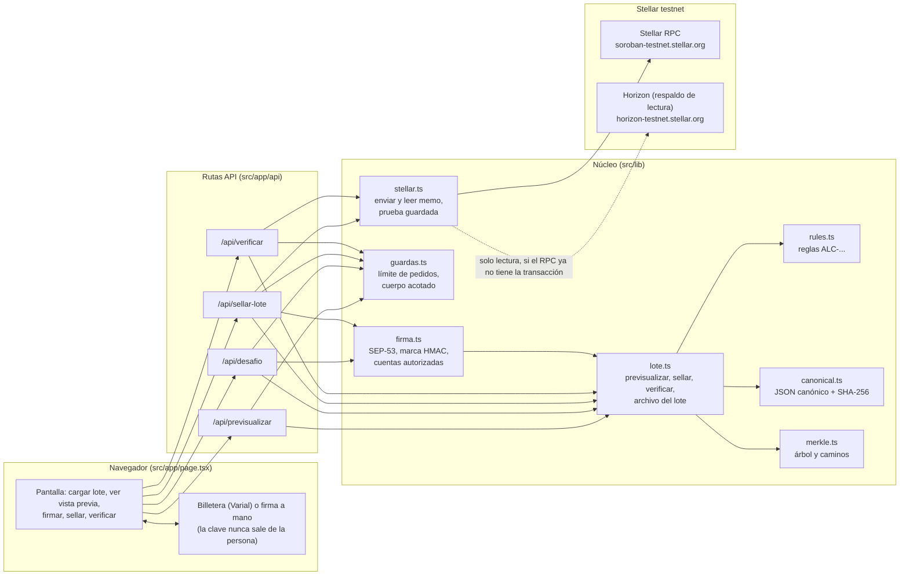
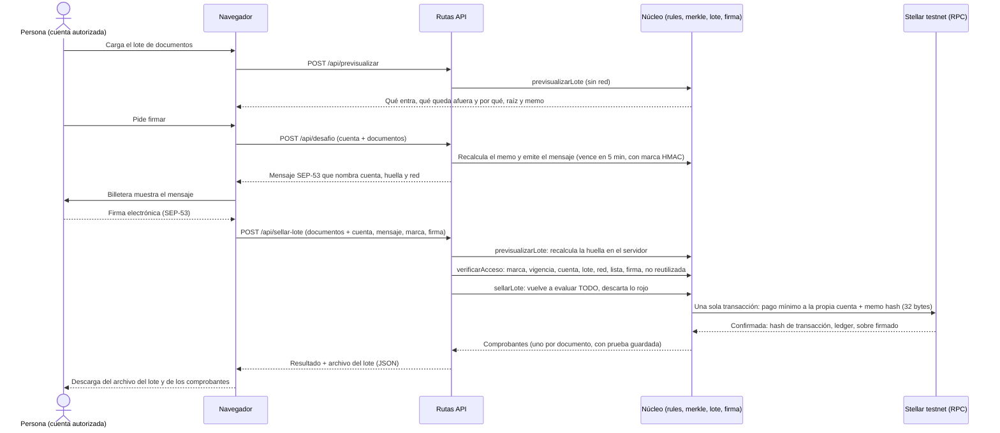
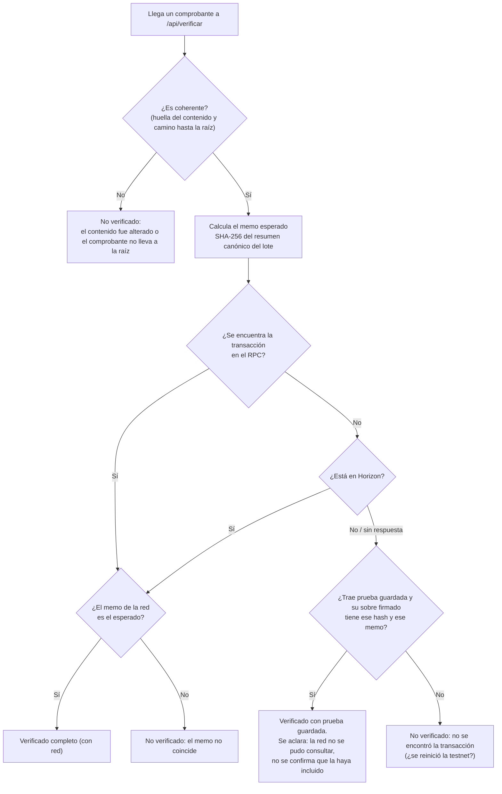

# Arquitectura de GALCOA+ en Stellar

Actualizado: 05/11/2026. Este documento describe lo que el código **hace hoy**. Si algo lo contradice, gana [`docs/producto/FUENTE-DE-VERDAD.md`](../producto/FUENTE-DE-VERDAD.md). Requisitos con ID en [`docs/producto/SRS.md`](../producto/SRS.md), alcance en [`docs/producto/MVP.md`](../producto/MVP.md), guía de la red en [la documentación oficial de Stellar](../investigacion/GUIA-STELLAR.md). Términos en el [glosario](GLOSARIO.md) y decisiones en los [ADR](../adr/README.md).

> **Estado real:** es un **prototipo de demostración** en **Stellar testnet** (red de pruebas, sin dinero real). Las siete reglas son de demostración, no el motor completo. Nada de esto implica aval de la Stellar Development Foundation.

## 1. Visión general en lenguaje simple

Dos empresas intercambian mercadería y cada entrega genera un registro (remito, cantidades, fechas, quién cargó y quién confirmó). GALCOA+ hace tres cosas, en este orden:

1. **Revisa cada registro con reglas fijas** (código, no inteligencia artificial). Cada registro sale **verde** (verificado), **amarillo** (declarado, con una advertencia) o **rojo** (requiere revisión de una persona).
2. **Deja afuera todo lo rojo.** Con los verdes y amarillos arma un solo "paquete" (un lote) y calcula una **huella** de 32 bytes que resume el paquete entero.
3. **Escribe solo esa huella en Stellar testnet**, dentro de una transacción mínima, y le entrega a cada documento un **comprobante**. Con el comprobante, cualquiera puede comprobar después que ese documento estaba en el lote, sin que los datos se publiquen en la red.

Antes de escribir en la red, una persona con una **cuenta autorizada** firma electrónicamente un mensaje que nombra la huella exacta del lote. Así queda registrado qué cuenta confirmó el sello.

Lo que **no** hace: no guarda documentos en la red, no maneja dinero, no usa la red principal, no decide con IA y no tiene base de datos (el servidor no guarda nada entre pedidos).

## 2. Diagrama de componentes

Cómo leerlo: la pantalla habla solo con las cuatro rutas; las rutas pasan primero por las guardas y después usan el núcleo; **solo `stellar.ts` toca la red**.

## 3. Diagrama de secuencia del sellado

Puntos importantes: la huella la **calcula el servidor**, nunca se confía en la que diga el navegador; si todo el lote es rojo, `sellarLote` **no llama a la red**; la clave de la cuenta selladora (`SELLADOR_STELLAR_SECRETO`) vive solo en el servidor y es distinta de la cuenta de la persona que firma.

## 4. Diagrama del flujo de verificación

La verificación **con red** y la verificación **con prueba guardada** no valen lo mismo, y la respuesta lo dice con claridad: la guardada demuestra qué contenía la transacción firmada, no que la red la haya incluido.

## 5. Módulo, responsabilidad y archivo

| Módulo | Responsabilidad | Archivo |
|---|---|---|
| Pantalla | Cargar lote, ver vista previa, firmar (Varial o a mano), sellar, descargar archivo, verificar | `src/app/page.tsx` |
| Vista previa | Mostrar qué se sellaría, sin red ni costo | `src/app/api/previsualizar/route.ts` |
| Desafío | Emitir el mensaje a firmar para ESE lote | `src/app/api/desafio/route.ts` |
| Sellado | Validar la firma, sellar y devolver comprobantes y archivo | `src/app/api/sellar-lote/route.ts` |
| Verificación | Verificar un comprobante con red o con prueba guardada | `src/app/api/verificar/route.ts` |
| Reglas | Reglas deterministas `ALC-...` y veredicto verde/amarillo/rojo (`reglas-demo-0.2`) | `src/lib/dominio/rules.ts` |
| Canónico | JSON con claves ordenadas y SHA-256 | `src/lib/dominio/canonical.ts` |
| Merkle | Árbol (hoja `0x00`, nodo `0x01`), camino y verificación del camino | `src/lib/dominio/merkle.ts` |
| Lote | `previsualizarLote`, `sellarLote`, `verificarComprobante`, `armarArchivo`, memo del lote | `src/lib/aplicacion/lote.ts` |
| Firma | Mensaje a firmar, marca HMAC, SEP-53, lista de cuentas autorizadas, anti-reutilización | `src/lib/stellar/firma.ts` |
| Guardas | Límite de pedidos por IP, cuerpo acotado (100 KB), rechazo de pedidos de otro sitio | `src/lib/servidor/guardas.ts` |
| Stellar | Enviar la transacción con memo hash, leer memo (RPC y Horizon), verificar prueba guardada | `src/lib/stellar/stellar.ts` |
| Pruebas | Reglas, Merkle, sellado, rojo sin red, firma, respaldo Horizon, prueba guardada | `tests/nucleo.test.ts` |
| CI | Tipos, pruebas, compilación y `npm audit` en cada cambio | `.github/workflows/ci.yml` |

## 6. Variables de entorno

Los secretos viven solo en variables de entorno (`.env.local`, nunca en git, nunca impresos). La red **no** es configurable: está fija en testnet en el código.

| Variable | Para qué sirve | Si falta |
|---|---|---|
| `SELLADOR_STELLAR_SECRETO` | Clave secreta de la cuenta de **testnet** que paga y envía la transacción de sellado. | `enviarMemo` falla ("Falta configurar la cuenta selladora de testnet"): no se puede sellar. |
| `CUENTAS_AUTORIZADAS` | Lista de cuentas públicas (G...) separadas por coma que pueden confirmar sellos. | En producción nadie puede sellar. En desarrollo vale cualquier cuenta con firma válida. |
| `DESAFIO_SECRETO` | Secreto para la marca HMAC que prueba que el mensaje lo emitió este servidor. | En producción no se puede emitir ni validar el mensaje (nadie sella). En desarrollo se usa un secreto efímero. |

## 7. Límites conocidos

Dicho con honestidad, para no prometer de más:

- **Servidor sin estado.** La lista de firmas ya usadas y el límite de pedidos viven en la memoria de cada instancia. La protección contra reutilización de una firma es de **mejor esfuerzo**: un reinicio o varias instancias pueden olvidarla. Lo que sí frena la reutilización siempre: el mensaje vence a los 5 minutos y nombra un lote y una cuenta concretos.
- **Una firma prueba una cuenta, no una persona.** Por eso existe la lista de cuentas autorizadas; no hay identidad real de usuarios.
- **Cuatro ojos incompleto.** Hoy la regla `ALC-ATR-01` solo comprueba que `cargadoPor` y `confirmadoPor` sean identificadores **distintos**. La regla de cuatro ojos completa (identidad real, quién carga no puede aprobar, firma electrónica con motivo y registro de auditoría) **no está implementada**.
- **La testnet se reinicia el 16/12/2026** y borra todo. Por eso cada comprobante guarda la red y la prueba (sobre firmado y hora del ledger), y el archivo del lote debe guardarse por fuera de la red. Aun así, los ejemplos con transacciones reales se perderán.
- **Una transacción por vez por cuenta selladora.** El número de secuencia obliga a un reintento si dos pedidos chocan; para más volumen habría que serializar.
- **Horizon es un respaldo** y su documentación lo marca en mantenimiento; puede dejar de responder.
- **Las reglas son de demostración** (7 reglas, `reglas-demo-0.2`). No hay fuente externa que confirme el dato: se acepta lo declarado.
- **Faltan** política de contenido (CSP), límite de pedidos distribuido y revisión por especialistas (ver `SECURITY.md`). No se usó ni se debe usar con dinero real ni datos personales.
- **GAMP 5:** el diseño apunta a poder validarse, pero el sistema **no** está validado ni se afirma que lo esté; faltan plan de validación y revisión de personas calificadas.

## Capas de `src/lib` (7/11/2026)
Cada carpeta solo puede apoyarse en las de su lista; una prueba (`tests/limites-de-arquitectura.test.ts`) falla si alguien cruza una raya.

| Capa | Qué hay | Puede usar |
|---|---|---|
| `dominio` | Reglas, huellas, árbol de Merkle, codificación, CSV, comisión: lógica pura | nada más |
| `agentes` | Registrador, verificador, flujo y evaluación de la IA | dominio |
| `documentos` | PDF y logo | dominio |
| `servidor` | Defensas de las rutas, límite de pedidos, caché corto, modo demostración | datos |
| `stellar` | Red, contratos, firma, multifirma, estado vivo | dominio, servidor, config |
| `datos` | Almacén (archivos o base), historial, rondas, confirmaciones, privacidad | dominio, servidor, stellar |
| `aplicacion` | `lote`: orquesta dominio, red y datos | todas las anteriores |
