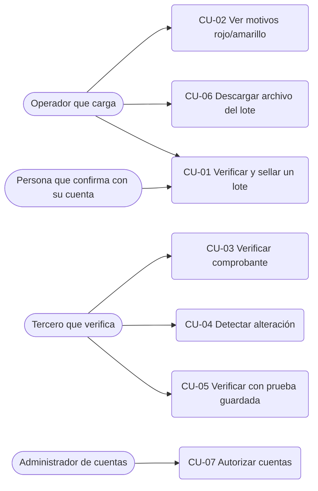
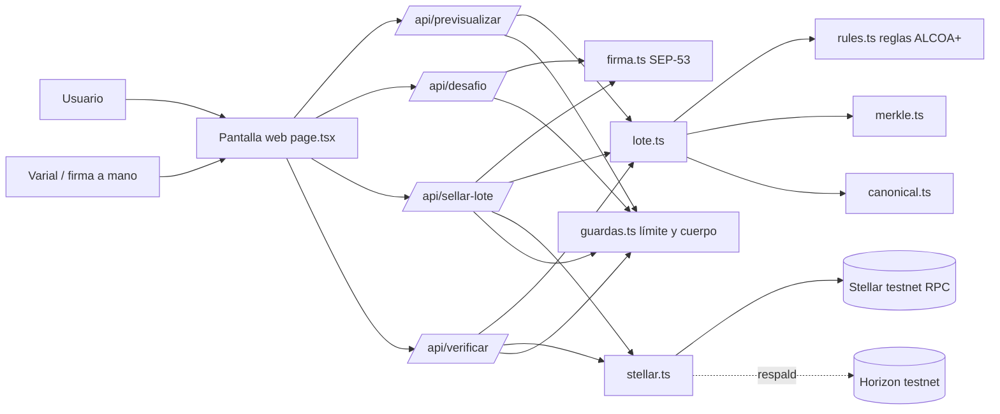

# SRS — Especificación de Requisitos de Software: GALCOA+ en Stellar

Versión 0.2 — 05/11/2026. Define **qué debe hacer la aplicación y cómo debe comportarse antes de seguir construyendo**. Está alineada con el código actual (40 pruebas automáticas pasando). Si algo la contradice, gana [docs/producto/FUENTE-DE-VERDAD.md](FUENTE-DE-VERDAD.md). Lo que todavía no existe en el código está marcado **[no implementado]**.

Documentos relacionados: [docs/producto/REQUISITOS-DE-DATO.md](REQUISITOS-DE-DATO.md) (ALCOA+ y enfoque GAMP 5) · [docs/arquitectura/ARQUITECTURA.md](../arquitectura/ARQUITECTURA.md) · [docs/producto/MVP.md](MVP.md) · [docs/arquitectura/GLOSARIO.md](../arquitectura/GLOSARIO.md) · [docs/adr/](../adr) (decisiones de diseño).

## 1. Introducción

### 1.1 Alcance
Aplicación web (prototipo) que recibe documentos de entrega entre empresas, los verifica con **reglas deterministas escritas en código**, muestra antes de sellar qué entraría al lote, pide la firma electrónica de una cuenta autorizada, ancla en **Stellar testnet** una **huella de 32 bytes por lote** (solo de lo verificado) y permite a cualquiera verificar después un documento con su comprobante. Cada lote se puede descargar como archivo con la prueba guardada.

**Fuera de alcance:** dinero real, red principal, custodia de fondos, emisión de activos, motor completo de reglas de GALCOA, fuente externa que confirme el dato, identidad real de las personas, almacenamiento de evidencias. Ver sección 5.

### 1.2 Objetivos
1. Mostrar que solo lo verificado llega a Stellar: lo rojo nunca.
2. Reducir transacciones: un lote de hasta 50 documentos en una sola transacción.
3. Dar a cada documento un comprobante que se verifica solo.
4. Dejar registrado qué cuenta confirmó cada sello.
5. Servir de base para integrar Stellar en GALCOA (sprint de 30 días).

## 2. Información del dominio del problema

### 2.1 Introducción
Las distribuidoras pymes registran entregas en papel o chat. Las diferencias de cantidad y los datos cargados a mano son difíciles de probar después. Una verificación previa con reglas y una prueba pública mejora la confianza entre las partes. La IA no decide ningún veredicto: lo deciden reglas en código y una persona revisa lo rojo.

### 2.2 Glosario de términos
| Término | Significado |
|---|---|
| Huella (hash) | Resumen SHA-256 de 32 bytes de un contenido. |
| Manifiesto | Documento evaluado + versión de reglas + IDs de reglas + veredicto; su huella es la hoja del árbol. |
| Lote | Conjunto de documentos (máx. 50) sellados juntos en una sola transacción. |
| Raíz (Merkle) | Huella única que representa a todo el lote. |
| Memo | Campo de 32 bytes de la transacción de Stellar; lleva la huella del lote. |
| Comprobante | Archivo JSON de un documento: manifiesto, camino hasta la raíz, red, transacción y prueba guardada. |
| Archivo del lote | JSON que junta el sellado y todos los comprobantes del lote. |
| Prueba guardada | Transacción firmada y hora de cierre del ledger, incluidas en el comprobante para revisarlo aunque la red olvide el historial. |
| Verde / amarillo / rojo | Verificado (se ancla) / declarado (se ancla marcado) / requiere revisión (no se ancla). |
| SEP-53 | Formato de Stellar para firmar un mensaje con la clave de una cuenta. |
| Cuenta autorizada | Cuenta de Stellar incluida en la lista del servidor para confirmar sellos. |
| ALCOA+ | Atributos de integridad de datos (atribuible, legible, contemporáneo, original, exacto, +completo, consistente, perdurable, disponible, trazable). |
| GAMP 5 | Guía para diseñar sistemas computarizados de modo que se puedan validar. |
| Testnet | Red de prueba de Stellar, sin dinero real; se reinicia (próxima: 16/12/2026). |

## 3. Necesidades de negocio

### 3.1 Objetivos de negocio de clientes y usuarios
| ID | Descripción | Prioridad | Criterio de aceptación |
|---|---|---|---|
| OB-01 | La distribuidora deja constancia confiable de una entrega | Alta | Un documento verde o amarillo recibe comprobante con transacción en testnet. |
| OB-02 | La marca o cliente comprueba que un dato fue verificado y no se alteró | Alta | Verificar un comprobante íntegro da "verificado"; uno alterado da "no verificado". |
| OB-03 | Una persona revisa lo que quedó rojo | Alta | Cada documento rojo muestra los IDs y motivos de las reglas que fallaron y no entra al lote. |
| OB-04 | Un tercero verifica un comprobante sin pedir permiso | Media | `/api/verificar` y la pantalla verifican sin cuenta ni código (con límite de pedidos). |
| OB-05 | Saber quién confirmó cada sello | Media | La respuesta y el archivo del lote registran la cuenta que firmó. |
| OB-06 | Conservar la prueba aunque la red olvide el historial | Media | El comprobante verifica contra la prueba guardada cuando la red no tiene la transacción, aclarando qué prueba y qué no. |

### 3.2 Modelos de procesos de negocio

#### 3.2.1 Actores
| Actor | Rol | Implementación actual |
|---|---|---|
| Operador que carga | Carga los documentos de entrega (JSON) en la pantalla y los revisa. | Pantalla web, sin cuenta propia. Su identificador va como texto en `cargadoPor`. |
| Persona que confirma con su cuenta | Firma con la clave de su cuenta de Stellar (Varial o a mano) la huella exacta del lote. | `firma.ts`, `/api/desafio`, `/api/sellar-lote`. |
| Tercero que verifica | Cualquiera con un comprobante: comprueba que el documento está en el lote sellado. | `/api/verificar` y pantalla; sin sesión. |
| Administrador de cuentas autorizadas | Define qué cuentas pueden confirmar sellos. | Variable de entorno `CUENTAS_AUTORIZADAS`; no hay pantalla de administración **[no implementado]**. |

#### 3.2.2 Procesos
1. **Carga y revisión.** El operador carga un lote (1 a 50 documentos). El sistema evalúa cada uno con las reglas y marca verde, amarillo o rojo con los IDs `ALC-...`. Lo rojo queda afuera y se explica por qué.
2. **Vista previa "qué se sella".** Sin tocar la red, el sistema muestra qué documentos entran, cuáles quedan afuera y por qué, y la raíz y el memo exactos que irían a Stellar.
3. **Firma SEP-53 y sellado.** La cuenta autorizada pide un mensaje, lo firma (válido 5 minutos, atado a la huella de ese lote y de un solo uso) y el sistema, tras volver a evaluar todo, envía **una** transacción con la huella en el memo y entrega los comprobantes.
4. **Verificación pública.** Un tercero pega un comprobante: el sistema recalcula la huella, sube por el camino hasta la raíz, calcula el memo esperado y lo compara con el memo leído de la red (RPC; Horizon como respaldo). Si la red no tiene la transacción, usa la prueba guardada y lo aclara.
5. **Archivo del lote.** Tras sellar, el operador descarga el JSON con el sellado, la cuenta que firmó y todos los comprobantes con su prueba guardada.

### 3.3 Casos de uso
| ID | Caso de uso | Actor | Precondición | Flujo | Resultado |
|---|---|---|---|---|---|
| CU-01 | Verificar y sellar un lote | Operador + persona que confirma | Hay documentos cargados; la cuenta está en la lista autorizada; la cuenta selladora de testnet está configurada | 1) Se cargan los documentos. 2) Se ve la vista previa. 3) La cuenta pide el mensaje (`/api/desafio`). 4) La cuenta lo firma. 5) `/api/sellar-lote` verifica la firma, reevalúa y envía una transacción. | Transacción en testnet con el memo del lote, comprobantes y archivo del lote; se registra la cuenta que firmó. |
| CU-02 | Ver por qué un documento quedó rojo o amarillo | Operador | Hay documentos cargados | 1) Se pide la vista previa o se sella. 2) Se lee la lista de avisos por documento. | Cada aviso muestra ID de regla y detalle; el rojo no entra al lote. |
| CU-03 | Verificar un comprobante contra Stellar | Tercero que verifica | Tiene el comprobante JSON | 1) Lo pega en la pantalla. 2) `/api/verificar` valida el comprobante, lee el memo de la red y compara. | "Verificado" con ledger y enlace al explorador, o "no verificado" con el paso que falló. |
| CU-04 | Detectar un documento alterado | Tercero que verifica | Tiene un comprobante modificado | Igual que CU-03. | "No verificado": el contenido no coincide con su huella o no lleva a la raíz. |
| CU-05 | Verificar con la prueba guardada | Tercero que verifica | Comprobante con prueba; la red ya no tiene la transacción | Igual que CU-03; sin transacción en la red se usa la prueba guardada. | Verificado por "prueba-guardada", aclarando que no confirma que la red la haya incluido. |
| CU-06 | Descargar el archivo del lote | Operador | Lote sellado | Botón "Descargar archivo del lote (JSON)". | JSON con sellado, cuenta firmante y comprobantes. |
| CU-07 | Autorizar cuentas | Administrador de cuentas | Acceso a la configuración del servidor | Editar `CUENTAS_AUTORIZADAS`. | Solo esas cuentas pueden confirmar. Sin pantalla propia **[no implementado]**. |

#### 3.3.1 Diagramas
Casos de uso:

Componentes:

### 3.4 Requisitos funcionales

**Módulo Reglas**
- RF-01 El sistema deberá evaluar cada documento con reglas deterministas y devolver verde, amarillo o rojo junto con los IDs de las reglas (ALC-COM-01, LEG-01, ATR-01, COH-01, CTE-01, ORI-01, EXA-01).
- RF-02 El sistema deberá marcar rojo cuando el identificador de quien carga sea igual al de quien confirma el dato (ALC-ATR-01). Además, el sistema deberá negarse a sellar (403) si la identidad de la cuenta que firma el sello coincide con quien cargó algún documento que entra al lote. La identidad de la cuenta sale de `CUENTAS_AUTORIZADAS` (`G...=usuario-01`). **Límite:** los identificadores `cargadoPor` y `confirmadoPor` siguen siendo texto declarado; no hay todavía usuarios con login.
- RF-03 El veredicto no deberá depender de IA; la misma entrada deberá dar siempre el mismo resultado.
- RF-12 El sistema deberá marcar rojo ("no se pudo leer") si faltan campos obligatorios o si hay tipos o formatos inválidos (fechas reales AAAA-MM-DD, cantidades enteras no negativas, identificadores internos, huella de 64 caracteres hexadecimales).
- RF-13 El sistema deberá marcar rojo si la fecha de registro es anterior a la de entrega (ALC-COH-01), y amarillo si se registró más de 3 días después (ALC-CTE-01).
- RF-14 El sistema deberá marcar amarillo si falta la huella del documento original (ALC-ORI-01), y, si la cantidad recibida difiere de la pedida, amarillo con observación o rojo sin ella (ALC-EXA-01).
- RF-15 El sistema deberá guardar en cada manifiesto la versión de reglas (`reglas-demo-0.2`) y los IDs evaluados.

**Módulo Lote y Merkle**
- RF-04 El sistema deberá incluir en el lote solo documentos verdes y amarillos; el rojo no deberá anclarse nunca.
- RF-05 El sistema no deberá llamar a la red si no hay documentos elegibles.
- RF-06 El sistema deberá anclar un lote de 1 a 50 documentos con **una** transacción cuyo memo sea la huella del resumen canónico del lote (cantidad de hojas, raíz, esquema `galcoa.batch.v1`) y deberá rechazar lotes vacíos o de más de 50.
- RF-07 El sistema deberá armar el árbol de Merkle (hoja = SHA-256(0x00 ‖ huella), nodo = SHA-256(0x01 ‖ izq ‖ der), nivel impar sube sin duplicar) y entregar a cada documento un comprobante con manifiesto, camino, raíz, red y transacción.

**Módulo Vista previa**
- RF-16 El sistema deberá calcular, sin tocar la red, qué documentos entran al lote, cuáles quedan afuera y por qué, y la raíz y el memo exactos que se sellarían, con la misma lógica que el sellado.
- RF-17 La vista previa no deberá exigir firma, pero sí tener límite de pedidos.

**Módulo Acceso por firma de cuenta SEP-53**
- RF-10 El sistema deberá exigir para sellar la firma SEP-53 de una cuenta autorizada sobre la huella exacta del lote, y registrar la cuenta que confirmó. Sin lista de cuentas configurada, en producción nadie podrá sellar.
- RF-18 El sistema deberá emitir un mensaje a firmar con marca HMAC propia, cuenta, huella del lote, red, vencimiento (5 minutos) y código; deberá rechazar mensajes inventados, vencidos, de otra cuenta, de otro lote o de otra red, firmas inválidas y firmas reutilizadas.
- RF-19 El sistema deberá recalcular la huella del lote en el servidor al sellar, sin confiar en lo que informe el navegador.
- RF-20 La pantalla deberá permitir firmar con Varial o pegando la cuenta y firmando a mano.

**Módulo Sellado en Stellar**
- RF-21 El sistema deberá enviar la huella como memo de tipo hash (32 bytes) en un pago mínimo de la cuenta selladora a sí misma, en testnet, esperar la confirmación y reintentar una vez si falla por número de secuencia.
- RF-22 El sistema deberá tomar la cuenta selladora solo de una variable de entorno y no deberá imprimirla ni devolverla.

**Módulo Comprobante y verificación**
- RF-08 El sistema deberá verificar un comprobante: recalcular la huella del manifiesto, subir por el camino hasta la raíz, calcular el memo esperado y compararlo con el memo leído de Stellar.
- RF-09 El sistema deberá detectar un documento, camino o raíz alterados.
- RF-11 La verificación deberá ser pública, con límite de pedidos.
- RF-23 El sistema deberá leer el memo primero por Stellar RPC y, si la transacción ya no está en su ventana (~7 días), por Horizon como respaldo.
- RF-24 El sistema deberá distinguir en la respuesta el paso que falló (`comprobante`, `red`) y el que pasó (`completo`, `prueba-guardada`).
- RF-25 El sistema deberá ofrecer un verificador público en su propia dirección (`/verificar`), sin cuenta ni firma, que acepte un comprobante suelto o el archivo del lote y no guarde nada.
- RF-26 El sistema deberá publicar en `/.well-known/stellar.toml` (SEP-1, con CORS abierto) la cuenta selladora y las cuentas autorizadas, sin repetir ni exponer claves secretas.

**Módulo Archivo del lote con prueba guardada**
- RF-27 El sistema deberá incluir en cada comprobante la prueba guardada (transacción firmada y hora de cierre del ledger), fuera de la huella del documento.
- RF-28 Si la red no tiene la transacción, el sistema deberá verificar contra la prueba guardada (el sobre firmado tiene el hash de transacción del comprobante y su memo es la huella esperada) y deberá aclarar que eso no confirma que la red la haya incluido.
- RF-29 El sistema deberá armar un archivo del lote (`galcoa.stellar.archivo.v1`) con el sellado, la cuenta firmante y todos los comprobantes, descargable desde la pantalla.

**Módulo Confirmación por terceros (ronda)** *(patrón portado del proyecto anterior del equipo; la confirmación simple del comercio sigue igual)*
- RF-30 El sistema deberá permitir crear una ronda de confirmación sobre un documento congelado, con un enlace privado por participante: proveedor y comprador obligatorios, transportista opcional. Prueba: `tests/ronda.test.ts`.
- RF-31 Cada enlace deberá ser un token de 32 bytes al azar (43 caracteres); en el almacén solo deberá guardarse su hash, y el enlace en claro deberá entregarse una única vez a quien crea la ronda.
- RF-32 Leer un enlace nunca deberá consumirlo; un enlace mal formado, inexistente o anulado deberá dar la misma respuesta. El participante solo deberá ver los datos públicos de la entrega.
- RF-33 Responder deberá exigir un nombre autodeclarado, ser de un solo uso, vencer, y rechazarse si los datos guardados ya no coinciden con la huella de la ronda. Dos respuestas simultáneas al mismo enlace: gana una sola; las de participantes distintos no deberán pisarse.
- RF-34 El estado de la ronda deberá ser `completa` solo si todos confirmaron el mismo documento y nadie lo rechazó; un rechazo deberá dejarla `rechazada`. La distribuidora deberá poder anular o reemitir el enlace de quien no respondió, nunca el de quien ya respondió. Las rondas y sus invitaciones deberán borrarse 30 días después de vencer.
- RF-35 El texto no deberá decir que la ronda "certifica" ni "valida": prueba que quien tenía cada enlace declaró lo que recibió, no quién es esa persona.

**Módulo Robustez de la verificación y de los agentes** *(patrones portados del proyecto anterior del equipo)*
- RF-36 El verificador público no deberá mostrar "todavía no figura en la red" cuando no pudo consultarla: solo un 404 prueba ausencia; una caída o un tiempo agotado deberá informarse como "no pudimos consultar la red". Prueba: `tests/ausencia-vs-caida.test.ts`.
- RF-37 El mensaje de la persona que se envía a los modelos deberá ir entre marcas con un código aleatorio por llamada, y los prompts deberán indicar que ese contenido es un dato y no una orden. Prueba: `tests/fuentes.test.ts`.
- RF-38 Si el texto de la persona parece dar órdenes a la IA (ignorar reglas, no reportar nada, aprobar sin controlar, hacerse pasar por el sistema), el sistema deberá retener cada entrega propuesta con un hallazgo crítico `ALC-INY-01`, decidido en código y sin depender de ningún modelo. Prueba: `tests/inyeccion.test.ts`.
- RF-39 Si la misma huella de evidencia respalda más de una entrega dentro de un lote, el sistema deberá marcar todas esas entregas en rojo (regla ALC-EVI-01) y no sellarlas. Es una detección determinista de reutilización, no una prueba de autenticidad; no compara contra lotes anteriores. Prueba: tests/evidencia.test.ts.
- RF-40 Si se adjunta una foto de evidencia, el sistema deberá comparar la fecha de toma de sus metadatos con las fechas de la entrega y marcar fotos sin fecha (amarillo), de otro día o posteriores al registro (rojo) y pasadas por programas de edición (amarillo) con la regla ALC-FOT-01. Es una revisión de metadatos, no una prueba de autenticidad. Estado: módulo de dominio probado (tests/foto.test.ts); falta conectarlo a la carga de archivos.
- RF-41 Si se adjunta una foto, el sistema deberá marcar en amarillo las que traigan marcas de IA en sus metadatos y en rojo las que además tengan cifras que no coincidan con lo declarado (ALC-FOT-01). Estado: la detección de marcas está probada; la lectura de cifras con visión falta.
- RF-42 Si se adjunta un audio, el sistema deberá darle a la persona una frase al azar y retener en rojo el audio cuya transcripción no la contenga dentro de 5 minutos (ALC-VOZ-01). Prueba que el audio es nuevo, no quién habla. Estado: regla de dominio probada (tests/voz.test.ts); falta la carga y la transcripción.
- RF-43 Un agente perito con skills (foto y voz) devolverá un informe de indicios; las reglas en código lo convertirán en ALC-MED-01 (edición o generación con IA; rojo si toca cantidades, calidad o precio), ALC-VOZ-02 (se entiende), ALC-VOZ-03 (voz sintética) y ALC-VOZ-04 (firma de cuenta autorizada sobre el audio). El perito solo puede frenar y sin informe la evidencia queda declarada. Estado: reglas y validación del informe probadas (tests/multimedia.test.ts); falta el agente y la carga de archivos.
- RF-44 La pantalla /evidencia deberá permitir cargar una foto (JPG, PNG o WebP, hasta 4 MB) y un audio con frase al azar, mostrar las reglas ALC-ORI-01, ALC-FOT-01, ALC-MED-01 y ALC-VOZ-01 a 04 con su veredicto, no guardar el archivo (solo su huella) y no dar nunca por verde una evidencia sin informe del perito. Prueba: tests/evidencia-multimedia.test.ts y e2e/evidencia.e2e.ts.
- RF-45 La huella de una evidencia (foto o audio) podrá adjuntarse a la carga de agentes solo si el mensaje cuenta una sola entrega; la pone el servidor, la regla de original (ALC-ORI-01) la usa y el modelo no puede fijarla. Prueba: tests/agentes-huella.test.ts.
- RF-46 El sistema deberá anotar la comisión realmente cobrada por la red en cada sello y mostrar en el historial un contador de comisiones que sume solo lo anotado e informe cuántos sellos no tienen el dato. Prueba: tests/comisiones.test.ts.
- RF-47 El verificador solo dará "verificado" si la transacción la originó una cuenta selladora conocida o el contrato de registro tiene el lote vigente; la prueba guardada nunca dará "verificado". Prueba: tests/verificar-origen.test.ts.
- RF-48 Si la red tarda en confirmar un sello, el sistema guardará el hash antes de esperar y un reintento lo consultará antes de armar otra transacción. Prueba: tests/sellado-pendiente.test.ts.
- RF-49 Todo dato que proponga el registrador deberá venir con una cita textual del mensaje (regla `ALC-PRO-01`); el código deberá comprobar que la cita aparezca en la fuente y que contenga el valor propuesto (la cantidad, en cifras o en palabras, o el texto). Una cita inexistente o que no respalde el valor deberá retener la entrega (rojo, salvo la observación, que queda en amarillo) y un dato sin cita no deberá quedar verde.
- RF-50 Los pedidos de la API que cargan, previsualizan o sellan lotes, y los que crean confirmaciones y rondas, deberán validarse con un esquema (Zod) antes de usarse; los mensajes de rechazo estarán en castellano y no mostrarán detalles internos.

### 3.5 Requisitos no funcionales
| ID | Categoría | Requisito |
|---|---|---|
| RNF-01 | Seguridad | El sistema deberá operar solo en testnet; la red está fija en el código y no es configurable desde afuera. |
| RNF-02 | Privacidad | A la red deberá ir solo una huella de 32 bytes; nunca datos personales ni documentos. Los comprobantes viven fuera de la red. |
| RNF-03 | Seguridad | Los secretos (`SELLADOR_STELLAR_SECRETO`, `DESAFIO_SECRETO`, `CUENTAS_AUTORIZADAS`) deberán estar solo en variables de entorno, nunca en git ni impresos; en producción `DESAFIO_SECRETO` es obligatorio. |
| RNF-04 | Seguridad | Las rutas deberán tener límite de pedidos por IP (mejor esfuerzo en servidor sin estado), cuerpo acotado (100 000 caracteres), rechazo de pedidos de otro sitio, exigencia de JSON, cabeceras de seguridad y errores con mensajes controlados, sin detalles internos. |
| RNF-05 | Trazabilidad | Cada comprobante deberá guardar los IDs de reglas y la versión de reglas; todo cambio de reglas cambia la versión. |
| RNF-06 | Rendimiento | La confirmación en Stellar tarda unos 10 s; la función de sellado admite hasta 60 s, la de verificación 30 s. |
| RNF-07 | Disponibilidad | Ante el reinicio de la testnet (16/12/2026) los comprobantes deberán guardar la red y la prueba guardada, y las pruebas deberán poder repetirse. |
| RNF-08 | Mantenibilidad | El proyecto deberá tener pruebas automáticas, tipos, `CLAUDE.md` y fuente de verdad; todo requisito nuevo lleva ID en este SRS y una prueba. |
| RNF-09 | Usabilidad | Los mensajes deberán estar en español simple y la pantalla deberá avisar que las reglas son de demostración. |
| RNF-10 | Lenguaje | Los documentos y la interfaz deberán decir "verificación de datos con fuente", nunca "cumple", "validado" ni "certificado"; firma electrónica, no digital; sin nombrar empresas ni casos reales ni implicar aval de la Stellar Development Foundation. |
| RNF-11 | Integridad | La serialización para calcular huellas deberá ser canónica (misma entrada, misma huella). |

## 4. Matriz de trazabilidad (requisito → archivo/función → prueba)
Pruebas en `tests/nucleo.test.ts`.

| Requisito | Archivo / función | Prueba |
|---|---|---|
| RF-01, RF-03 | `src/lib/dominio/rules.ts` `evaluar` | "documento completo, atribuible, a tiempo, con original y exacto es verde"; "es determinista: misma entrada, mismo resultado"; "basura es rojo" |
| RF-02 | `rules.ts` ALC-ATR-01; `lote.ts` `cargadoresDelLote`; `firma.ts` `identidadDe`; `/api/sellar-lote` | "Atribuible: quien carga no puede confirmar (cuatro ojos) → rojo"; "RF-02 cuatro ojos completo…" (3 pruebas). La negativa 403 de la ruta: revisión de código |
| RF-12 | `rules.ts` ALC-COM-01, ALC-LEG-01 | "Completo: faltan campos → rojo"; "Legible: fecha imaginaria, cantidades no enteras o negativas → rojo" |
| RF-13 | `rules.ts` ALC-COH-01, ALC-CTE-01 | "Consistente: registro anterior a la entrega → rojo"; "Contemporáneo: carga tardía → amarillo" |
| RF-14 | `rules.ts` ALC-ORI-01, ALC-EXA-01 | "Original: sin huella del original → amarillo"; "Exacto: diferencia con observación → amarillo; sin observación → rojo" |
| RF-15, RNF-05 | `lote.ts` `sellarLote` (manifiesto), `VERSION_REGLAS` | "el rojo queda afuera del lote y los demás entran en una sola transacción" (comprobantes con versión e IDs) |
| RF-04, RF-05 | `lote.ts` `sellarLote` | "un lote con solo rojos NUNCA llama a la red"; "el rojo queda afuera del lote y los demás entran en una sola transacción" |
| RF-06 | `lote.ts` `sellarLote`, `memoDelLote` | "el rojo queda afuera del lote y los demás entran en una sola transacción"; "rechaza lotes vacíos y demasiado grandes" |
| RF-07 | `src/lib/dominio/merkle.ts` `construir`, `camino`; `lote.ts` | "todos los documentos de un lote de N se verifican" (1 a 8 hojas) |
| RF-08 | `lote.ts` `verificarComprobante`; `/api/verificar`; `stellar.ts` `leerMemo` | "todos los documentos de un lote de N se verifican"; "el rojo queda afuera del lote y los demás entran en una sola transacción" |
| RF-09 | `verificarComprobante`, `merkle.ts` `verificarCamino` | "un documento alterado no verifica"; "una raíz alterada no verifica"; "un comprobante con el contenido alterado se detecta" |
| RF-10, RF-18 | `src/lib/stellar/firma.ts` `emitirDesafio`, `verificarAcceso` | "una cuenta autorizada con firma válida pasa"; "en producción sin lista de cuentas nadie puede sellar"; "una cuenta que no está en la lista no pasa, aunque firme bien"; "un mensaje inventado (sin marca del servidor) no pasa"; "una firma de otra cuenta sobre el mensaje no pasa"; "el mensaje vence y no se puede reutilizar"; "sin firma o sin nada para sellar no pasa" |
| RF-18 (formato SEP-53) | `firma.ts` `hashSep53`, `verificarFirmaSep53` | "la firma sigue el formato SEP-53 (prefijo + SHA-256) y detecta cambios" |
| RF-49 | `src/lib/dominio/procedencia.ts`; `flujo.ts` | `tests/procedencia.test.ts` |
| RF-50 | `src/lib/dominio/esquemas.ts`; `leerCuerpo` en `guardas.ts` | `tests/esquemas.test.ts` |
| RF-19 | `/api/sellar-lote` (recalcula con `previsualizarLote`) | "la firma de un lote no sirve para otro lote" |
| RF-16 | `lote.ts` `previsualizarLote`; `/api/previsualizar` | "anticipa exactamente la raíz y el memo que después se sellan, sin llamar a la red"; "si todo es rojo no hay raíz ni memo"; "rechaza lotes vacíos o demasiado grandes" |
| RF-17, RF-11, RNF-04 | `src/lib/servidor/guardas.ts` `limitar`, `leerJson`; `next.config` | Sin prueba automática; revisión de código |
| RF-20 | `src/app/page.tsx` (Varial y firma a mano) | Sin prueba automática; prueba manual |
| RF-21, RF-22, RNF-01 | `stellar.ts` `enviarMemo` (red fija, secreto de entorno) | Sin prueba automática (usa la red); probado a mano en testnet; revisión de código |
| RF-23 | `stellar.ts` `leerMemo`, `memoDeHorizon` | "interpreta una transacción exitosa con memo de tipo hash"; "rechaza fallidas, otros tipos de memo y basura" |
| RF-24 | `/api/verificar` | Sin prueba automática de la ruta; revisión de código |
| RF-27, RF-28 | `stellar.ts` `verificarPruebaLocal`; `lote.ts` | "el comprobante lleva la prueba y se verifica sin red"; "una prueba con otro memo o con otro hash de transacción se rechaza" |
| RF-29 | `lote.ts` `armarArchivo` | "el archivo del lote junta el sellado con todos los comprobantes" |
| RNF-02 | `stellar.ts` (memo de 32 bytes), `lote.ts` `memoDelLote` | "el rojo queda afuera del lote y los demás entran en una sola transacción" (una sola huella enviada) |
| RNF-11 | `src/lib/dominio/canonical.ts` | "es determinista: misma entrada, mismo resultado" y pruebas del memo |
| RNF-03, RNF-07, RNF-10 | Configuración y revisión de documentos | Revisión; sin prueba automática |
| RF-25 | `src/app/verificar/page.tsx` → `/api/verificar` | Sin prueba automática de la página; probada a mano |
| RF-26 | `src/lib/stellar/toml.ts`; `src/app/.well-known/stellar.toml/route.ts` | "RF-26 stellar.toml (SEP-1)" (2 pruebas) |

## 5. Fuera de alcance y supuestos

**Fuera de alcance (no implementado):**
- Usuarios reales con login: `cargadoPor` y `confirmadoPor` son identificadores de texto declarados, y la cuenta que aprueba el sello se asocia a una identidad solo por configuración. **[no implementado]**
- Multifirma nativa de Stellar (cuenta de sellado que exija dos firmantes): no probada. **[no implementado]**
- Pantalla de administración de cuentas autorizadas (hoy variable de entorno). **[no implementado]**
- Motor completo de reglas de GALCOA, fuente externa que confirme el dato, identidad real de las personas, firma electrónica con motivo, almacenamiento de evidencias, piso de auditoría append-only. Ver [docs/producto/REQUISITOS-DE-DATO.md](REQUISITOS-DE-DATO.md).
- Dinero real, red principal, custodia de fondos, emisión de activos, pagos condicionados y x402: requieren consulta legal previa y no se tocan.
- Plan de validación GAMP 5 y revisión por personas calificadas: el sistema está diseñado para poder validarse, pero no está validado.

**Supuestos:**
- Una firma prueba que una cuenta firmó, no quién es la persona detrás; por eso existe la lista de cuentas autorizadas.
- Cualquiera puede escribir un memo en Stellar: lo que se garantiza es la procedencia (el sello viene de las cuentas de GALCOA tras reglas y confirmación), no limpiar la red.
- Una transacción a la vez por cuenta selladora (hay un reintento; para más volumen habrá que serializar).
- El límite de pedidos y el control de firmas ya usadas son de mejor esfuerzo en un servidor sin estado.
- Horizon figura en mantenimiento en la documentación de Stellar; se usa solo como respaldo.
- Las reglas son de demostración (`reglas-demo-0.2`).
- Los datos de la testnet se pierden en el reinicio del 16/12/2026.

## 6. Estado y entregables

**Hecho y probado** (40 pruebas automáticas pasando):
- Reglas deterministas ALCOA+ con tres estados; lo rojo nunca llega a la red.
- Lote con árbol de Merkle, una transacción por lote, comprobantes y detección de alteración.
- Vista previa "qué se sella" sin red.
- Acceso por firma de cuenta SEP-53 con lista de cuentas, vencimiento y un solo uso.
- Sellado en testnet (probado a mano: lote de 7 documentos en una transacción) y lectura de la red con respaldo Horizon.
- Prueba guardada en el comprobante y archivo del lote descargable.
- Pantalla web (con Varial o firma a mano), límite de pedidos, cuerpo acotado, cabeceras de seguridad.

**No hecho:** lo marcado **[no implementado]** en las secciones 3.4 y 5, el despliegue en Vercel, y la validación formal.

**Entregables:** este SRS · [docs/producto/FUENTE-DE-VERDAD.md](FUENTE-DE-VERDAD.md) · [docs/producto/REQUISITOS-DE-DATO.md](REQUISITOS-DE-DATO.md) · [docs/arquitectura/ARQUITECTURA.md](../arquitectura/ARQUITECTURA.md) · [docs/producto/MVP.md](MVP.md) · [docs/arquitectura/GLOSARIO.md](../arquitectura/GLOSARIO.md) · [docs/adr/](../adr) · tablero (`docs/producto/TABLERO.md`) · código fuente y MVP funcionando en testnet (repositorio privado).

*Prototipo de demostración. No implica aval de la Stellar Development Foundation.*
